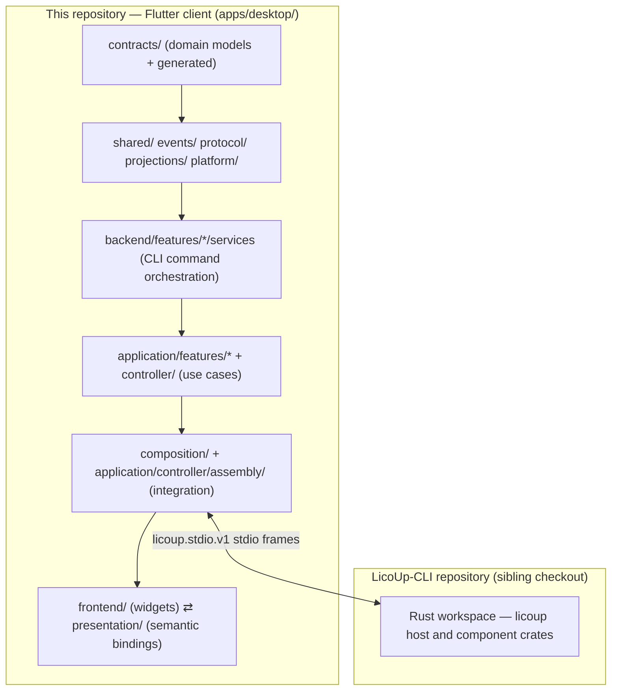

# LicoUp Parallel Development Map

| Related Document | Language / Path | Authority |
|:---|:---|:---|
| **Normative Version** | English (Normative) | Authoritative parallel development map |
| **Localization** | [简体中文](PARALLEL-DEVELOPMENT-MAP.zh-CN.md) | Localized Chinese projection |
| **Architecture** | [docs/architecture/README.md](../architecture/README.md) | Authoritative architecture tiers and vertical slices |
| **Contribution Rules** | [CONTRIBUTING.md](../../CONTRIBUTING.md) | Commit identity, gate, and agent contribution rules |
| **Runbook** | [docs/RUNBOOK.md](../RUNBOOK.md) | Operational checklists and gate execution |
| **Documentation Index** | [docs/README.md](../README.md) | Complete documentation table of contents |

This map tells a developer — especially an autonomous coding agent — which
upcoming feature work can proceed **in parallel** with another developer or
agent currently editing the same repository. It records the repository's
parallel-safety facts: which directories share no files, which files are
global integration bottlenecks that must not be edited by two parties at
once, and where the boundary with the sibling LicoUp-CLI repository lies.

It is a **process map**, not an architecture specification. All architectural
facts are owned by `docs/architecture/README.md` and its children; all
contribution rules are owned by `CONTRIBUTING.md`. This document only maps
where work can safely run concurrently.

---

## 1. Repository Topology

This repository carries the LicoUp desktop client and the tooling that
verifies it:

- **Flutter client** — `apps/desktop/` (contracts, platform services, backend
  services, application use cases, composition, presentation/projections and
  frontend layers).
- **Node tooling and shared suites** — `tools/` (build and verification
  scripts) and `tests/` (client contract suites). `docs/`, `schemas/`,
  `brand/`, and `packages/` are low-churn, cross-cutting directories.

The Rust workspace — `crates/licoup/` and the component crates it
integrates — lives in the sibling
[LicoUp-CLI](https://github.com/LicoLand/LicoUp-CLI) component repository,
which owns the Rust build. This repository consumes the pinned sidecar
release recorded in `tools/licoup-cli-release.json` and carries no Rust
sources, so every change here is file-disjoint from every LicoUp-CLI change
by construction.

The only cross-repository surface is the client–native bridge contract:
`licoup.stdio.v1` frames spoken to the staged sidecar, the mirrored
conversation protocol under `schemas/conversation_protocol/`, and the
generated Dart contracts under `apps/desktop/lib/src/contracts/generated/`.

---

## 2. Parallel-Safety Model

Three facts determine whether two work items can run in parallel:

1. **File disjointness** — the two changes touch no common files. This is the
   only hard requirement.
2. **Contract stability** — if a change alters a public surface (an
   application-layer gateway interface, a `schemas/` contract consumed by
   generated code, or a shared tool contract), every consumer of that
   surface must be updated. Contract-breaking work is serial by nature.
3. **Checkout isolation** — the Flutter client and Node tooling build
   independently of the Rust workspace in LicoUp-CLI, so cross-repository
   work never conflicts at the file level.

Rules of thumb:

- **Parallel-safe**: changes confined to one vertical domain slice whose
  files live in that domain's own directories, single-layer changes, UI-only
  changes, and test-only changes in a domain's own test directory.
- **Parallel-unsafe**: any two changes that both touch a global integration
  file (see Section 5), and two changes to the same generated contract file.
- **Serial by dependency**: a change that consumes a new API must land after
  the change that introduces it. The repository convention is to define the
  contract in the owning gateway interface or `schemas/` source first, then
  integrate in `composition/`.

---

## 3. The LicoUp-CLI Boundary

The Rust workspace — including the `licoup` host crate, its command
modules, platform drivers and domain modules — lives in the sibling
LicoUp-CLI repository, which owns the crate-level parallel-safety rules for
Rust work. From this repository's perspective:

- **All LicoUp-CLI work is file-disjoint with all work here.** Two agents
  can hold the two checkouts in parallel with no merge surface.
- **The coupling surfaces are the pinned release manifest
  `tools/licoup-cli-release.json`, the mirrored protocol
  `schemas/conversation_protocol/`, and the generated bridge contracts.** A
  new native method surface reaches this repository only through a
  LicoUp-CLI release bump plus contract regeneration; treat that pair as
  one serial change.
- **Rust internals are out of scope for this map.** Crate layout,
  `src/ffi/commands/`, `src/domain/` and `src/platform/` parallel-safety
  are owned by the LicoUp-CLI repository's own documentation.

---

## 4. Flutter Client: Vertical Domain Slices

The Flutter client is organized as **vertical domain slices** crossing the
layers `contracts/` → `platform/` → `backend/features/*/services/` →
`application/features/*` → `projections/` / `presentation/` →
`frontend/features/*`.

Each domain owns its directories in every layer it spans — files from
`skill_hub`, `devices`, and `targets` never overlap:

| Domain slice | `application/features/` | `backend/features/` | `frontend/features/` | `presentation/` + `projections/` | Notes |
|:---|:---|:---|:---|:---|:---|
| **agents / conversations** | `agents/`, `conversations/` | `agents/`, `conversations/` | `agents/` | `agents/`, `conversation/` | Largest slice; spans all layers |
| **devices** | `devices/` | `devices/` | `devices/` | `devices/` | Includes pairing, session custody notices, device cards |
| **skill_hub** | `skill_hub/` | `skill_hub/` | `skill_hub/` | `skill_hub/` | Full vertical slice |
| **settings** | `settings/` | `settings/` | `settings/` | `settings/` | Update, resource usage, log export |
| **targets** | `targets/` | — | `targets/` | `targets/` | |
| **agent_hub** | `agent_hub/` | — | `agent_hub/` | `agent_hub/` | |
| **projects** | `projects/` | — | `projects/` (top-level `frontend/`) | `projects/` | |
| **collaboration** | — | — | `collaboration/` | `collaboration/` | Frontend-side slice |
| **plugin_management** | `plugin_management/` | — | `plugin_management/`, `plugin_window/` | `plugin_management/`, `plugin_window/` | Adapter plugins |
| **models** | `models/` | — | `models/` | `models/` | LLM gateway lifecycle |
| **runtime_control** | `runtime_control/` | — | `runtime_control/` | — | |
| **continuous_assistant** | — | — | `continuous_assistant/` | — | Frontend-only slice |
| **layout** | `layout/` | — | `layout/` (top-level `frontend/`) | `layout/` | Presentation layout registry |
| **navigation** | `navigation/` | — | (shell hooks) | — | |
| **catalog_convergence** | `catalog_convergence/` | — | (settings status card) | — | |
| **mcp** | `mcp/` | — | — | — | Application-layer only |
| **messaging** | `messaging/` | — | — | — | Application-layer only |

Within one slice, layer boundaries are the natural seams: the
application-layer gateway interfaces in
`application/features/<domain>/contracts/` are the contracts that `backend/`
services and `composition/` adapters must honor. Freeze the gateway
interface, and each layer's implementation can proceed in parallel.

Highest-parallelism, lowest-risk work: single-layer domains (`mcp`,
`messaging`, `navigation`, `catalog_convergence`, `continuous_assistant`),
pure UI work in `frontend/features/`, and thin
`presentation/`/`projections/` surfaces.

---

## 5. Global Integration Bottlenecks (Do Not Parallelize)

The following files are touched by nearly every domain. Two concurrent changes
must never both edit them; assign them to one owner or serialize them:

| File | Why it is a bottleneck |
|:---|:---|
| `apps/desktop/lib/src/application/controller/client_controller.dart` | Root controller aggregating all domains |
| `apps/desktop/lib/src/composition/built_in_layout_composition.dart` | Sole file allowed to assemble renderer ownership surface bundles |
| `apps/desktop/lib/src/application/controller/assembly/*_component_assembly.dart` | Per-domain assembly points, but co-located and cross-referenced |
| `apps/desktop/lib/src/application/controller/client_component_assembly.dart` | Component assembly root |
| `apps/desktop/lib/src/contracts/generated/*` | Generated bridge contracts — regenerate serially, never hand-edit |
| `schemas/conversation_protocol/` and `tools/licoup-cli-release.json` | Mirrored cross-repository protocol and the pinned sidecar release — advance serially |
| `tools/verify-documentation.mjs`, `tools/verify-client-boundary.mjs` | Central verification gates |
| `docs/README.md` | Documentation index — every new doc adds a line here |

The generated contract directory and the mirrored protocol are single-writer
surfaces: regenerate them serially, in the same change as the schema or
release edit that caused the regeneration.

---

## 6. Cross-Repository and Generated-Contract Rules

- The Flutter–native boundary is the **bridge contract**: `licoup.stdio.v1`
  frames carried by the pinned LicoUp-CLI sidecar. Changing a method shape is
  a cross-repository contract change: the LicoUp-CLI release, the mirrored
  `schemas/conversation_protocol/` sources and the Dart-side generated
  contract land in a strictly ordered sequence — release first, then mirror
  and regenerate here.
- **Generated files** (`apps/desktop/lib/src/contracts/generated/`) are
  produced by `npm run client:contracts:generate` from
  `schemas/client_bridge/`. They must not be hand-edited. Two parallel
  changes that both regenerate will conflict; regenerate serially after each
  side's schema change lands.
- When a feature needs a new client-bridge contract, define the schema in
  `schemas/client_bridge/` first, regenerate, then implement against the
  generated types. Methods owned by the native protocol registry reach this
  repository through the pinned LicoUp-CLI release and the mirrored
  `schemas/conversation_protocol/` sources.

---

## 7. Test Suites and Their Parallelism

Tests are organized by domain and are file-disjoint just like source:

- **Flutter widget/unit tests** — `apps/desktop/test/` (400+ files) mirror
  the domain slices: `agent_conversation_*`, `skill_hub_*`, `devices_*`,
  plus per-slice subdirectories (`devices/`, `messaging/`, `layout/`,
  `agent_usage_timeline/`, `goldens/`).
- **Node contract tests** — `tests/contract/client/` exercises the client
  tool and packaging contracts; it is the slowest and most
  environment-dependent suite in this repository.
- **Rust and product end-to-end suites** — live in the LicoUp-CLI repository
  with the workspace they test.

Parallel test strategy is already defined by
[ADR 0006: Capability-aware parallel client regression](../adrs/0006-capability-aware-parallel-regression.md)
and `CONTRIBUTING.md` — it governs **parallel test execution** (shared
foundation first, then parallel frontend/backend, then parallel
platform/agent frontier) with capacity caps and no-shell constraints.

For parallel development, the rule is: a domain's tests live in that domain's
test directories, so test work parallelizes with the same boundaries as source
work. The one shared exception is `apps/desktop/test/flutter_test_config.dart`
and any golden-file manifest updates — treat them as serial.

---

## 8. Concrete Parallel Work Combinations

### 8.1 Ready to parallelize (file-disjoint today)

| Work item A | Work item B | Why they do not conflict |
|:---|:---|:---|
| Flutter `devices` slice (application + frontend + backend) | Flutter `skill_hub` slice | Zero overlapping files across all layers |
| Flutter `agents` slice UI (`frontend/features/agents/`) | Flutter `settings` slice | Disjoint feature directories |
| `application/features/mcp` (single-layer) | `application/features/messaging` (single-layer) | Application-layer only, disjoint |
| Flutter UI work in `frontend/features/*` | Any change in the LicoUp-CLI checkout | Different repositories; only the release pin and mirrored protocol couple them |
| Domain test work (`apps/desktop/test/skill_hub_*` etc.) | Any other domain test work | Test files mirror domain slices |
| Documentation work | Any non-documentation work | `docs/` is disjoint from code directories |

### 8.2 Require sequencing (do not parallelize)

| Work item A | Work item B | Why they conflict |
|:---|:---|:---|
| Two changes regenerating `contracts/generated/` | each other | Generated files are single-writer |
| Two changes editing `client_controller.dart` / `built_in_layout_composition.dart` | each other | Global integration files |
| A gateway-interface public API change | Any `composition/` work consuming that API | Consumer must land after (or with) the API change |
| A `schemas/` contract change | Any other change regenerating the same contract outputs | Contract change and its generated files land together |
| A `tools/licoup-cli-release.json` pin bump plus `schemas/conversation_protocol/` mirror update | Any other change staging a different release pin | One pinned sidecar release at a time |

---

## 9. Working with Another Active Agent

When you detect that another developer or agent is currently modifying the
repository:

1. **Check the map first** — identify which slice the other party's change
   set touches (by file paths), then pick work that is file-disjoint per
   Sections 4–5 and 8.1.
2. **Never share the bottleneck files** (Section 5). If your planned change
   touches one, either wait for the other party or coordinate explicitly.
3. **Prefer contract-first changes** — introduce or extend a gateway
   interface or `schemas/` contract, then integrate. This turns serial
   dependency into two parallel implementations against a frozen contract.
4. **Respect the contribution identity rules** of
   [CONTRIBUTING.md](../../CONTRIBUTING.md): every commit carries exactly one
   verified human identity; an agent may assist but never replace, overwrite,
   or claim the developer's authorship, and repository hooks must not be
   bypassed.
5. **Verify before handing off** — run the relevant gates for your slice
   (`npm run repo:docs` for documentation, `npm run client:test` for client
   code; contract changes also rerun `npm run client:contracts:generate`)
   so the integration point is never double-broken. Gate details live in
   [docs/RUNBOOK.md](../RUNBOOK.md).
