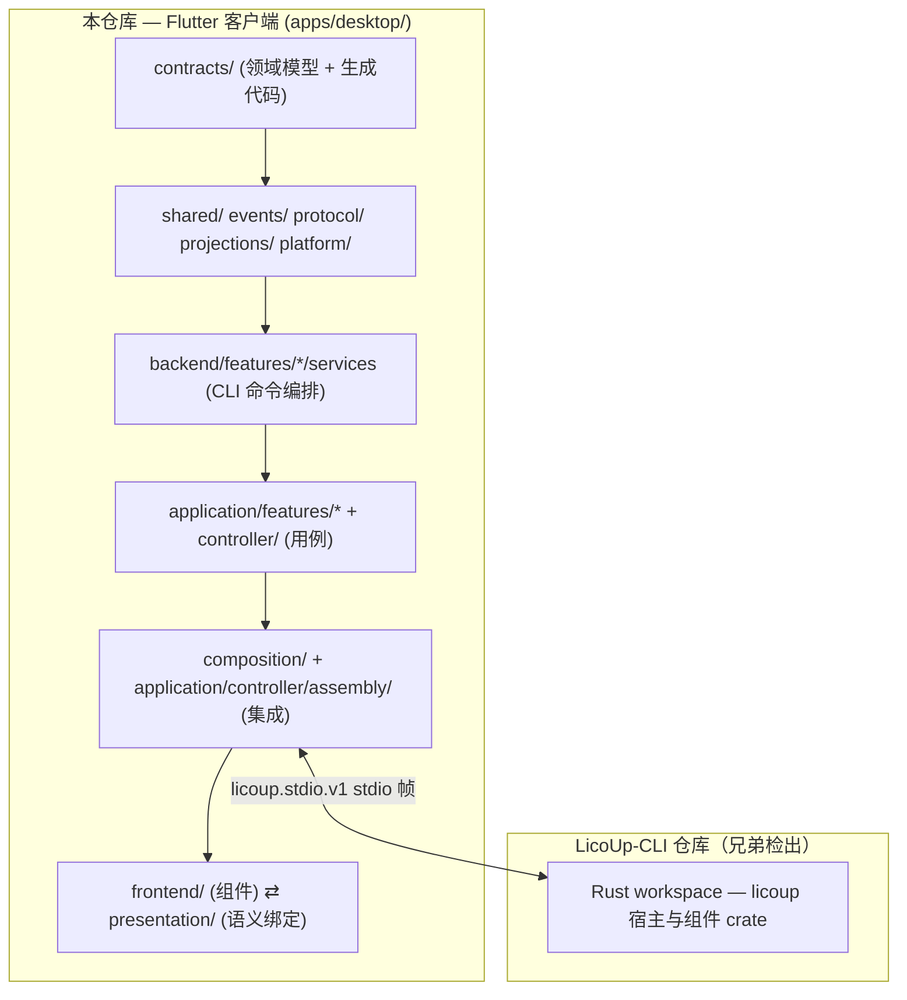

# LicoUp 并行开发地图

| 关联文档 | 语言 / 路径 | 权威性 |
|:---|:---|:---|
| **规范版本** | [English (Normative)](PARALLEL-DEVELOPMENT-MAP.md) | 权威并行开发地图 |
| **本地化** | 简体中文（本文件） | 中文投影 |
| **架构** | [docs/architecture/README.md](../architecture/README.md) | 权威架构分层与纵向切片 |
| **贡献规则** | [CONTRIBUTING.md](../../CONTRIBUTING.md) | 提交身份、门禁与智能体贡献规则 |
| **运维手册** | [docs/RUNBOOK.md](../RUNBOOK.md) | 运维清单与门禁执行 |
| **文档索引** | [docs/README.md](../README.md) | 完整文档目录 |

本地图帮助开发者——尤其是正在仓库中工作的自主编码智能体——判断**即将开发的功能可以和哪些功能并行进行**，特别是当发现此刻有另一个开发者或智能体正在修改同一仓库时。它记录仓库的并行安全事实：哪些目录零文件重叠、哪些文件是全局集成瓶颈、绝不能由两方同时修改，以及与兄弟仓库 LicoUp-CLI 的边界在哪里。

这是一份**流程地图**，不是架构规范。所有架构事实归 `docs/architecture/README.md` 及其子文档所有；所有贡献规则归 `CONTRIBUTING.md` 所有。本文档只标注哪些工作可以安全地并发进行。

---

## 1. 仓库拓扑

本仓库承载 LicoUp 桌面客户端及其验证工具链：

- **Flutter 客户端** — `apps/desktop/`（contracts、平台服务、后端服务、应用用例、composition、presentation/projections 与 frontend 各层）。
- **Node 工具链与共享套件** — `tools/`（构建与验证脚本）与 `tests/`（客户端 contract 套件）。`docs/`、`schemas/`、`brand/`、`packages/` 是低变更率的横切目录。

Rust workspace——`crates/licoup/` 及其集成的组件 crate——位于兄弟组件仓库 [LicoUp-CLI](https://github.com/LicoLand/LicoUp-CLI)，Rust 构建归其所有。本仓库消费 `tools/licoup-cli-release.json` 记录的固定版本 sidecar 发布产物，不携带任何 Rust 源码；因此本仓库的任何改动与 LicoUp-CLI 的任何改动在构造上必然文件不相交。

唯一的跨仓库面是客户端–原生桥接契约：与已暂存 sidecar 通信的 `licoup.stdio.v1` 帧、`schemas/conversation_protocol/` 下镜像的对话协议，以及 `apps/desktop/lib/src/contracts/generated/` 下的 Dart 生成契约。

---

## 2. 并行安全模型

三项事实决定两个工作项能否并行：

1. **文件不相交** — 两个改动不触碰任何共同文件。这是唯一硬性要求。
2. **契约稳定** — 若改动改变了公开面（应用层网关接口、被生成代码消费的 `schemas/` 契约、或共享工具契约），该面的所有消费者都必须同步更新。破坏契约的工作本质上只能串行。
3. **检出隔离** — Flutter 客户端与 Node 工具链独立于 LicoUp-CLI 中的 Rust workspace 构建，跨仓库工作从不在文件层面冲突。

经验法则：

- **可并行**：改动局限于某个纵向功能域切片（文件只在该域自己的目录里）、单层改动、纯 UI 改动、以及该域自身测试目录内的测试改动。
- **不可并行**：任何两个同时触碰全局集成文件（见第 5 节）的改动、同一生成契约文件的两处改动。
- **按依赖串行**：消费新 API 的改动必须晚于引入该 API 的改动。仓库惯例是先在所属网关接口或 `schemas/` 源中定义契约，再在 `composition/` 中集成。

---

## 3. LicoUp-CLI 边界

Rust workspace——包括 `licoup` 宿主 crate、其命令模块、平台驱动与领域模块——位于兄弟仓库 LicoUp-CLI，Rust 工作的 crate 级并行安全规则归其所有。从本仓库视角看：

- **所有 LicoUp-CLI 工作与本仓库所有工作文件不相交。** 两个智能体可以并行持有两个检出，不存在合并面。
- **耦合面是固定发布清单 `tools/licoup-cli-release.json`、镜像协议 `schemas/conversation_protocol/` 与生成桥接契约。** 新的原生方法面只能通过 LicoUp-CLI 发布版本升级加契约重新生成到达本仓库；将这一对操作视为一次串行变更。
- **Rust 内部结构超出本地图范围。** crate 布局、`src/ffi/commands/`、`src/domain/` 与 `src/platform/` 的并行安全性归 LicoUp-CLI 仓库自己的文档所有。

---

## 4. Flutter 客户端：纵向功能域切片

Flutter 客户端按**纵向功能域切片**组织，贯穿 `contracts/` → `platform/` → `backend/features/*/services/` → `application/features/*` → `projections/` / `presentation/` → `frontend/features/*` 各层。

每个功能域在它跨越的每一层都拥有自己的目录 — `skill_hub`、`devices`、`targets` 的文件从不重叠：

| 功能域切片 | `application/features/` | `backend/features/` | `frontend/features/` | `presentation/` + `projections/` | 备注 |
|:---|:---|:---|:---|:---|:---|
| **agents / conversations** | `agents/`、`conversations/` | `agents/`、`conversations/` | `agents/` | `agents/`、`conversation/` | 最大切片；贯穿全部层 |
| **devices** | `devices/` | `devices/` | `devices/` | `devices/` | 含配对、会话保管通知与设备卡 |
| **skill_hub** | `skill_hub/` | `skill_hub/` | `skill_hub/` | `skill_hub/` | 完整纵向切片 |
| **settings** | `settings/` | `settings/` | `settings/` | `settings/` | 更新、资源用量、日志导出 |
| **targets** | `targets/` | — | `targets/` | `targets/` | |
| **agent_hub** | `agent_hub/` | — | `agent_hub/` | `agent_hub/` | |
| **projects** | `projects/` | — | `projects/`（顶层 `frontend/`） | `projects/` | |
| **collaboration** | — | — | `collaboration/` | `collaboration/` | 前端侧切片 |
| **plugin_management** | `plugin_management/` | — | `plugin_management/`、`plugin_window/` | `plugin_management/`、`plugin_window/` | 适配器插件 |
| **models** | `models/` | — | `models/` | `models/` | LLM 网关生命周期 |
| **runtime_control** | `runtime_control/` | — | `runtime_control/` | — | |
| **continuous_assistant** | — | — | `continuous_assistant/` | — | 仅前端切片 |
| **layout** | `layout/` | — | `layout/`（顶层 `frontend/`） | `layout/` | 展示布局注册表 |
| **navigation** | `navigation/` | — | （shell 钩子） | — | |
| **catalog_convergence** | `catalog_convergence/` | — | （settings 内状态卡） | — | |
| **mcp** | `mcp/` | — | — | — | 仅应用层 |
| **messaging** | `messaging/` | — | — | — | 仅应用层 |

单个切片内部，层边界就是天然接缝：`application/features/<domain>/contracts/` 中的应用层网关接口是 `backend/` 服务与 `composition/` 适配器必须遵守的契约。冻结网关接口后，各层实现即可并行推进。

并行度最高、风险最低的工作：单层功能域（`mcp`、`messaging`、`navigation`、`catalog_convergence`、`continuous_assistant`）、`frontend/features/` 下的纯 UI 工作、以及 `presentation/`/`projections/` 的薄展示面。

---

## 5. 全局集成瓶颈（不可并行化）

以下文件几乎被每个功能域触碰。任何两个并发改动都绝不能同时编辑它们；指定一个负责人或串行处理：

| 文件 | 为什么是瓶颈 |
|:---|:---|
| `apps/desktop/lib/src/application/controller/client_controller.dart` | 聚合所有功能域的根控制器 |
| `apps/desktop/lib/src/composition/built_in_layout_composition.dart` | 唯一允许组装 renderer 所有权 surface bundle 的文件 |
| `apps/desktop/lib/src/application/controller/assembly/*_component_assembly.dart` | 按域拆分的组装点，但集中存放且互相引用 |
| `apps/desktop/lib/src/application/controller/client_component_assembly.dart` | 组件组装根 |
| `apps/desktop/lib/src/contracts/generated/*` | 生成桥接契约 — 必须串行重新生成，绝不手改 |
| `schemas/conversation_protocol/` 与 `tools/licoup-cli-release.json` | 跨仓库镜像协议与固定 sidecar 发布版本 — 串行推进 |
| `tools/verify-documentation.mjs`、`tools/verify-client-boundary.mjs` | 中央验证门禁 |
| `docs/README.md` | 文档索引 — 每份新文档都在这里加一行 |

生成契约目录与镜像协议是单写者面：必须串行重新生成，并与触发重新生成的 schema 或发布改动落在同一变更中。

---

## 6. 跨仓库与生成契约规则

- Flutter–原生边界是**桥接契约**：由固定版本 LicoUp-CLI sidecar 承载的 `licoup.stdio.v1` 帧。修改方法形状就是跨仓库契约变更：LicoUp-CLI 发布、镜像的 `schemas/conversation_protocol/` 源与 Dart 侧生成契约必须按严格顺序落地 — 先发布，再在本仓库镜像并重新生成。
- **生成文件**（`apps/desktop/lib/src/contracts/generated/`）由 `npm run client:contracts:generate` 从 `schemas/client_bridge/` 产出，不得手改。两个并行改动若都触发重新生成会冲突；应在一方 schema 变更落地后串行重新生成。
- 功能需要新客户端桥接契约时，先在 `schemas/client_bridge/` 定义 schema，重新生成，再基于生成类型实现。归原生协议注册表所有的方法面经由固定版本 LicoUp-CLI 发布与镜像的 `schemas/conversation_protocol/` 源到达本仓库。

---

## 7. 测试套件与并行性

测试按功能域组织，与源码一样文件不相交：

- **Flutter widget/单元测试** — `apps/desktop/test/`（400+ 文件）镜像功能域切片：`agent_conversation_*`、`skill_hub_*`、`devices_*`，另有按切片划分的子目录（`devices/`、`messaging/`、`layout/`、`agent_usage_timeline/`、`goldens/`）。
- **Node contract 测试** — `tests/contract/client/` 覆盖客户端工具与打包契约；是本仓库最慢、最依赖环境的套件。
- **Rust 与产品端到端套件** — 随其测试的 workspace 一起位于 LicoUp-CLI 仓库。

并行**测试执行**策略已由 [ADR 0006：能力感知的并行客户端回归](../adrs/0006-capability-aware-parallel-regression.md) 与 `CONTRIBUTING.md` 定义（先共享基础，再并行 frontend/backend，再并行 platform/Agent frontier），含容量上限与无 shell 约束。

对并行开发而言规则是：某功能域的测试位于该域自己的测试目录，因此测试工作与源码工作遵循同样的并行边界。唯一的共享例外是 `apps/desktop/test/flutter_test_config.dart` 与任何 golden 文件清单更新 — 视为串行。

---

## 8. 具体的并行工作组合

### 8.1 现在即可并行（当前文件不相交）

| 工作项 A | 工作项 B | 为什么互不冲突 |
|:---|:---|:---|
| Flutter `devices` 切片（application + frontend + backend） | Flutter `skill_hub` 切片 | 全部层零文件重叠 |
| Flutter `agents` 切片 UI（`frontend/features/agents/`） | Flutter `settings` 切片 | 功能目录不相交 |
| `application/features/mcp`（单层） | `application/features/messaging`（单层） | 仅应用层，不相交 |
| `frontend/features/*` 的 Flutter UI 工作 | LicoUp-CLI 检出中的任何改动 | 不同仓库；仅发布固定与镜像协议耦合 |
| 功能域测试工作（`apps/desktop/test/skill_hub_*` 等） | 任意其他功能域测试工作 | 测试文件镜像功能域切片 |
| 文档工作 | 任意非文档工作 | `docs/` 与代码目录不相交 |

### 8.2 需要排序（不可并行）

| 工作项 A | 工作项 B | 为什么冲突 |
|:---|:---|:---|
| 两个都重新生成 `contracts/generated/` 的改动 | 彼此 | 生成文件是单写者 |
| 两个都编辑 `client_controller.dart` / `built_in_layout_composition.dart` 的改动 | 彼此 | 全局集成文件 |
| 网关接口公开 API 改动 | 任何消费该 API 的 `composition/` 工作 | 消费者必须晚于（或随）API 改动落地 |
| `schemas/` 契约改动 | 任何其他重新生成同一契约产物的改动 | 契约改动与其生成文件一起落地 |
| `tools/licoup-cli-release.json` 固定版本升级加 `schemas/conversation_protocol/` 镜像更新 | 任何其他暂存不同发布版本的改动 | 同一时间只有一个固定 sidecar 发布版本 |

---

## 9. 与另一个活跃智能体协同

当发现另一个开发者或智能体正在修改仓库时：

1. **先查本地图** — 按文件路径判断对方的变更集属于哪个切片，然后按第 4–5 节与 8.1 选择文件不相交的工作。
2. **绝不共享瓶颈文件**（第 5 节）。若你的计划改动触碰瓶颈文件，要么等待对方，要么显式协调。
3. **优先做契约优先的改动** — 先引入或扩展网关接口或 `schemas/` 契约，再集成。这把串行依赖变成两个基于冻结契约的并行实现。
4. **遵守 [CONTRIBUTING.md](../../CONTRIBUTING.md) 的提交身份规则**：每个提交恰好携带一个已验证的人类身份；智能体可以协助，但绝不能取代、覆盖或冒认开发者的作者身份，仓库 hooks 不得绕过。
5. **交接前先验证** — 运行你所属切片的门禁（文档用 `npm run repo:docs`，客户端代码用 `npm run client:test`；契约改动还需重跑 `npm run client:contracts:generate`），确保集成点不会被双重破坏。门禁细节见 [docs/RUNBOOK.md](../RUNBOOK.md)。
